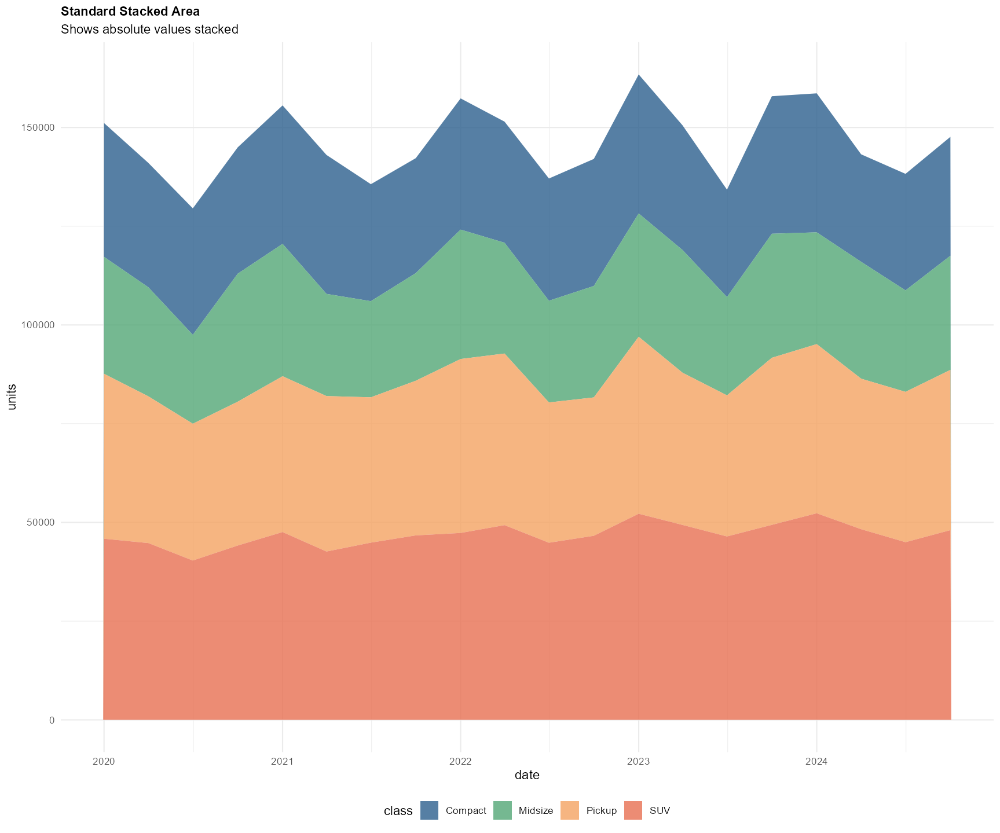

## Introduction

Area plots are powerful visualizations for showing volume and magnitude over time. They work like line plots but with the area below the line filled, emphasizing the quantity or volume of change. Stacked area plots are particularly useful for showing how different components contribute to a total over time.

In this tutorial, we'll visualize vehicle production volumes by class over time, showing both individual trends and the total market composition.

::: {.callout .info}
**What Makes Area Plots Powerful:**

Area plots excel at: - Emphasizing magnitude and volume over time - Showing part-to-whole relationships (stacked areas) - Comparing cumulative totals across categories - Highlighting the "weight" or importance of trends - Visualizing ranges or confidence intervals (ribbon plots)
:::

{fig-align="center"}

## Setup

First, let's load the required packages and create our data:

```{r}
#| label: setup
#| message: false
#| warning: false

# Load required libraries
library(tidyverse)      # Includes ggplot2, dplyr, and other essential packages
library(scales)         # For formatting numbers and dates
library(lubridate)      # For working with dates

# Set seed for reproducibility
set.seed(123)

# Create simulated quarterly production data (2020-2024)
quarters <- seq(as.Date("2020-01-01"), as.Date("2024-10-01"), by = "quarter")

# Create production volume data for different vehicle classes
data_production <- tibble(
  date = rep(quarters, 4),
  class = rep(c("Compact", "SUV", "Midsize", "Pickup"), each = length(quarters))
) %>%
  mutate(
    # Base production levels
    base_units = case_when(
      class == "SUV" ~ 45000,
      class == "Pickup" ~ 38000,
      class == "Compact" ~ 32000,
      class == "Midsize" ~ 28000
    ),
    # Add growth trend
    trend = as.numeric(date - min(date)) / 365 * case_when(
      class == "SUV" ~ 800,
      class == "Pickup" ~ 600,
      class == "Compact" ~ -200,
      class == "Midsize" ~ 100
    ),
    # Add seasonality (Q4 is highest production)
    season = 3000 * sin(2 * pi * (quarter(date) - 1) / 4 + pi/2),
    # Add random variation
    noise = rnorm(n(), 0, 2000),
    # Combine components
    units = pmax(base_units + trend + season + noise, 0)
  ) %>%
  select(date, class, units)

# Preview the data
head(data_production, 10)
```

------------------------------------------------------------------------

## Chart 1: Basic Area Plot

Let's start with a simple area plot showing production volume for one vehicle class.

```{r}
#| label: chart-basic
#| fig-width: 10
#| fig-height: 6

# Filter for one class to start simple
compact_data <- data_production %>%
  filter(class == "Compact")

ggplot(compact_data, aes(x = date, y = units)) +
  geom_area()                                       # Create filled area
```

### Code Explanation

**Lines 2-3:** Filters the data to show only one vehicle class (Compact) for simplicity

**Line 5:** `ggplot(compact_data, aes(x = date, y = units))` - Maps date to x-axis and production units to y-axis

**Line 6:** `geom_area()` - Creates the area plot by filling the space between the line and y=0

::: {.highlight-box .info}
**What we have so far:** A functional area plot showing the volume of production, but it lacks context, proper formatting, colors, and styling. The filled area emphasizes volume better than a line plot would, but needs enhancement.
:::

------------------------------------------------------------------------

## Chart 2: Intermediate Enhancement

Now we'll improve the styling, add colors, better formatting, and show multiple classes as a stacked area chart.

::: {.highlight-box .warning}
**What we're adding in this evolution:**

-   **Stacked areas** showing all vehicle classes together
-   **Custom color palette** for different classes
-   **Formatted axes** with proper date and number formatting
-   **Better labels and title** providing context
-   **Legend styling** for clarity
-   **Grid improvements** for easier reading
-   **Thousand separators** in y-axis labels
-   **Transparency and borders** for better definition
:::

```{r}
#| label: chart-intermediate
#| fig-width: 10
#| fig-height: 7

ggplot(data_production, aes(x = date, y = units, fill = class)) +
  geom_area(alpha = 0.8, color = "white", linewidth = 0.5) +  # Add white borders between areas
  scale_x_date(
    date_breaks = "6 months",                       # Break every 6 months
    date_labels = "%b %Y",                          # Format as "Jan 2020"
    expand = expansion(mult = c(0, 0))              # No padding on edges
  ) +
  scale_y_continuous(
    labels = label_comma(suffix = " units"),        # Add commas and "units"
    expand = expansion(mult = c(0, 0.05))           # Start at 0, small padding on top
  ) +
  scale_fill_manual(
    values = c(
      "Compact" = "#2C5F8D",                        # Blue
      "SUV" = "#E76F51",                            # Coral
      "Midsize" = "#52A675",                        # Green
      "Pickup" = "#F4A261"                          # Orange
    ),
    name = "Vehicle Class"
  ) +
  labs(
    title = "Quarterly Vehicle Production by Class",
    subtitle = "Stacked area chart showing total production volume (2020-2024)",
    x = "Quarter",
    y = "Production Volume",
    caption = "Data: Simulated quarterly production units"
  ) +
  theme_minimal(base_size = 12) +
  theme(
    plot.title = element_text(face = "bold", size = 16, hjust = 0.5, margin = margin(b = 8)),
    plot.subtitle = element_text(size = 11, color = "#5A6C7D", hjust = 0.5, margin = margin(b = 15)),
    plot.caption = element_text(size = 9, color = "#6C757D", hjust = 1, margin = margin(t = 10)),
    axis.title = element_text(face = "bold", size = 11),
    axis.text = element_text(size = 10),
    axis.text.x = element_text(angle = 45, hjust = 1),
    legend.position = "bottom",
    legend.title = element_text(face = "bold", size = 11),
    legend.text = element_text(size = 10),
    panel.grid.minor = element_blank(),
    panel.grid.major.x = element_blank(),
    panel.grid.major.y = element_line(color = "#E9ECEF", linewidth = 0.5)
  )
```

### Code Explanation

**Line 1:** `aes(x = date, y = units, fill = class)` - Maps the fill color to vehicle class, which creates stacked areas

**Line 2:** `geom_area(alpha = 0.8, color = "white", linewidth = 0.5)` - Creates stacked areas with 80% opacity and thin white borders separating each class

**Lines 3-7:** `scale_x_date()` - Formats date axis with 6-month breaks and readable labels, removes padding so area starts at plot edge

**Lines 8-11:** `scale_y_continuous()` - Formats y-axis with comma separators and "units" suffix, starts at zero (important for area plots)

**Lines 12-20:** `scale_fill_manual()` - Applies custom color palette distinguishing each vehicle class

**Lines 21-27:** Comprehensive labeling explaining what the stacked areas represent

**Lines 28-42:** Theme customization with centered titles, angled x-axis labels, bottom legend, and only horizontal gridlines (vertical ones clutter area plots)

::: {.highlight-box .success}
**What we have now:** A much more informative stacked area chart showing how different vehicle classes contribute to total production over time. The white borders help distinguish layers, colors are meaningful, and formatting is professional. We can now see both individual class trends and total production volume.
:::

------------------------------------------------------------------------

## Chart 3: Advanced Visualization

Let's create a publication-ready area plot with annotations, percentage view, and sophisticated styling.

::: {.highlight-box .warning}
**What we're adding in this final evolution:**

-   **Percentage stacking** showing proportion rather than absolute values
-   **Interactive labels** at key points showing exact values
-   **Trend annotations** highlighting important changes
-   **Market share insights** in the visualization
-   **Enhanced color scheme** with better contrast
-   **Optimized ordering** (largest to smallest for better readability)
-   **Data callouts** showing specific insights
-   **Professional typography** and spacing
-   **Dual-panel view** (absolute + percentage)
:::

```{r}
#| label: chart-advanced
#| fig-width: 12
#| fig-height: 10

# Calculate totals and percentages for annotations
total_production <- data_production %>%
  group_by(date) %>%
  summarise(total = sum(units))

data_with_totals <- data_production %>%
  left_join(total_production, by = "date") %>%
  mutate(percentage = (units / total) * 100)

# Get latest quarter data for annotations
latest_data <- data_with_totals %>%
  filter(date == max(date)) %>%
  arrange(desc(units))

# Create percentage-based stacked area (position = "fill")
p1 <- ggplot(data_production, aes(x = date, y = units, fill = class)) +
  geom_area(position = "fill", alpha = 0.85, color = "white", linewidth = 0.8) +
  
  # Add annotations for latest quarter percentages
  annotate(
    "text",
    x = max(data_production$date) + 30,
    y = c(0.15, 0.40, 0.67, 0.88),
    label = paste0(
      c("Compact: ", "Midsize: ", "Pickup: ", "SUV: "),
      round(latest_data$percentage, 1), "%"
    ),
    hjust = 0,
    size = 3.5,
    fontface = "bold",
    color = c("#2C5F8D", "#52A675", "#F4A261", "#E76F51")
  ) +
  
  scale_x_date(
    date_breaks = "6 months",
    date_labels = "%b\n%Y",
    expand = expansion(mult = c(0, 0.15))           # Extra space for annotations
  ) +
  
  scale_y_continuous(
    labels = label_percent(),
    expand = expansion(mult = c(0, 0))
  ) +
  
  scale_fill_manual(
    values = c(
      "SUV" = "#E76F51",                            # Largest - most prominent color
      "Pickup" = "#F4A261",
      "Midsize" = "#52A675",
      "Compact" = "#2C5F8D"
    ),
    breaks = c("SUV", "Pickup", "Midsize", "Compact")  # Order by size
  ) +
  
  labs(
    title = "Market Share Evolution: SUVs Dominate Vehicle Production",
    subtitle = "Percentage of total quarterly production by vehicle class | SUVs grew from 28% to 32% market share (2020-2024)",
    x = NULL,
    y = "Percentage of Total Production",
    caption = NULL
  ) +
  
  theme_minimal(base_size = 13) +
  theme(
    plot.title = element_text(
      face = "bold",
      size = 16,
      hjust = 0,
      margin = margin(b = 8),
      color = "#2C3E50"
    ),
    plot.subtitle = element_text(
      size = 11,
      color = "#5A6C7D",
      hjust = 0,
      margin = margin(b = 15),
      lineheight = 1.3
    ),
    axis.title.y = element_text(face = "bold", size = 11, margin = margin(r = 10)),
    axis.text = element_text(size = 10),
    legend.position = "none",                       # Remove legend (using direct labels)
    panel.grid.minor = element_blank(),
    panel.grid.major.x = element_blank(),
    panel.grid.major.y = element_line(color = "#E9ECEF", linewidth = 0.5),
    plot.margin = margin(15, 15, 5, 15)
  )

# Create absolute value stacked area
p2 <- ggplot(data_production, aes(x = date, y = units, fill = class)) +
  geom_area(alpha = 0.85, color = "white", linewidth = 0.8) +
  
  # Add annotation for total production trend
  geom_line(
    data = total_production,
    aes(x = date, y = total, group = 1),
    inherit.aes = FALSE,
    color = "#2C3E50",
    linewidth = 1.2,
    linetype = "dashed"
  ) +
  
  annotate(
    "text",
    x = as.Date("2022-06-01"),
    y = 180000,
    label = "Total Production\n(dashed line)",
    size = 3.5,
    fontface = "italic",
    color = "#2C3E50",
    lineheight = 0.9
  ) +
  
  # Highlight a specific period (e.g., pandemic recovery)
  annotate(
    "rect",
    xmin = as.Date("2021-01-01"),
    xmax = as.Date("2021-12-31"),
    ymin = 0,
    ymax = Inf,
    alpha = 0.1,
    fill = "gray"
  ) +
  
  annotate(
    "text",
    x = as.Date("2021-06-01"),
    y = 185000,
    label = "Recovery Year",
    size = 3.5,
    fontface = "bold",
    color = "gray30"
  ) +
  
  scale_x_date(
    date_breaks = "6 months",
    date_labels = "%b\n%Y",
    expand = expansion(mult = c(0, 0.02))
  ) +
  
  scale_y_continuous(
    labels = label_comma(suffix = " units"),
    breaks = seq(0, 200000, by = 50000),
    expand = expansion(mult = c(0, 0.05))
  ) +
  
  scale_fill_manual(
    values = c(
      "SUV" = "#E76F51",
      "Pickup" = "#F4A261",
      "Midsize" = "#52A675",
      "Compact" = "#2C5F8D"
    ),
    breaks = c("SUV", "Pickup", "Midsize", "Compact"),
    name = "Vehicle Class"
  ) +
  
  labs(
    title = NULL,
    subtitle = "Absolute production volumes showing total market growth of 18% over 5 years",
    x = "Quarter",
    y = "Production Volume (Units)",
    caption = "Data: Simulated quarterly production data (2020-2024) | Top: Market share view | Bottom: Absolute volume view\nDashed line shows total production trend | Shaded area indicates recovery period | Visualization: Your Name"
  ) +
  
  theme_minimal(base_size = 13) +
  theme(
    plot.subtitle = element_text(
      size = 11,
      color = "#5A6C7D",
      hjust = 0,
      margin = margin(b = 15)
    ),
    plot.caption = element_text(
      size = 9,
      color = "#6C757D",
      hjust = 0,
      margin = margin(t = 15),
      lineheight = 1.2
    ),
    axis.title = element_text(face = "bold", size = 11),
    axis.title.x = element_text(margin = margin(t = 10)),
    axis.title.y = element_text(margin = margin(r = 10)),
    axis.text = element_text(size = 10),
    legend.position = "bottom",
    legend.direction = "horizontal",
    legend.title = element_text(face = "bold", size = 11, margin = margin(b = 5)),
    legend.text = element_text(size = 10),
    legend.key.size = unit(1, "cm"),
    panel.grid.minor = element_blank(),
    panel.grid.major.x = element_blank(),
    panel.grid.major.y = element_line(color = "#E9ECEF", linewidth = 0.5),
    plot.margin = margin(5, 15, 15, 15)
  )

# Combine both plots
library(patchwork)
p1 / p2 + plot_layout(heights = c(1, 1.2))
```

### Code Explanation

**Lines 2-11:** Calculates total production and percentages for each class, used for creating annotations with exact market share values

**Lines 13-16:** Extracts the most recent quarter's data for labeling current market shares

**Lines 18-92:** **First plot (p1) - Percentage view:**

-   **Line 19:** `geom_area(position = "fill")` - Creates percentage-stacked areas where each layer shows proportion of total (always sums to 100%)
-   **Lines 22-33:** Direct annotations showing exact percentages for each class in the latest quarter
-   **Lines 47-54:** Ordered fill scale putting largest category (SUV) first for better visual hierarchy
-   **Lines 56-61:** Data-driven title highlighting the key insight (SUV dominance and growth)

**Lines 94-197:** **Second plot (p2) - Absolute volume view:**

-   **Lines 97-103:** `geom_line()` overlays total production as a dashed line on top of stacked areas
-   **Lines 119-130:** `annotate("rect")` highlights a specific year (recovery period) with shaded background
-   **Lines 161-167:** Detailed caption explaining both views and methodology

**Lines 199-200:** Uses `patchwork` package to stack both plots vertically with adjusted heights

::: {.highlight-box .success}
**Final result:** A publication-ready dual-panel visualization showing both perspectives: market share evolution (percentage) and absolute growth (units). The percentage view reveals composition changes while the absolute view shows total market expansion. Direct labels, annotations, and a highlighted period provide rich context. The combination tells a complete story: SUVs are gaining market share while the total market is growing, meaning all segments can still be profitable.
:::

------------------------------------------------------------------------

## Comparison: All Three Charts

Here's how our area plots evolved:

| Aspect | Basic | Intermediate | Advanced |
|----|----|----|----|
| **Data Shown** | Single series | Multiple stacked | Dual view (% + absolute) |
| **Context** | None | Basic labels | Rich annotations + insights |
| **Comparison** | Not possible | Relative sizes | Both share and volume |
| **Insights** | None visible | Some trends | Explicit findings highlighted |
| **Formatting** | Default | Professional | Publication-ready |
| **Annotations** | None | None | Multiple (labels, periods, totals) |

------------------------------------------------------------------------

## Area Plot Variations

Different types of area plots for different purposes:

```{r}
#| label: variations
#| fig-width: 12
#| fig-height: 10

# Create four variations
library(patchwork)

# 1. Standard stacked area
v1 <- ggplot(data_production, aes(x = date, y = units, fill = class)) +
  geom_area(alpha = 0.8) +
  scale_fill_manual(values = c("Compact" = "#2C5F8D", "SUV" = "#E76F51", 
                               "Midsize" = "#52A675", "Pickup" = "#F4A261")) +
  labs(title = "Standard Stacked Area", subtitle = "Shows absolute values stacked") +
  theme_minimal() +
  theme(legend.position = "bottom", plot.title = element_text(face = "bold", size = 11))

ggsave("arechart.png", plot = v1, dpi = 144)

# 2. Percentage stacked (position = "fill")
v2 <- ggplot(data_production, aes(x = date, y = units, fill = class)) +
  geom_area(position = "fill", alpha = 0.8) +
  scale_y_continuous(labels = label_percent()) +
  scale_fill_manual(values = c("Compact" = "#2C5F8D", "SUV" = "#E76F51", 
                               "Midsize" = "#52A675", "Pickup" = "#F4A261")) +
  labs(title = "Percentage Stacked Area", subtitle = "Shows proportions (always 100%)") +
  theme_minimal() +
  theme(legend.position = "bottom", plot.title = element_text(face = "bold", size = 11))

# 3. Overlapping areas (no stacking)
v3 <- ggplot(data_production, aes(x = date, y = units, fill = class)) +
  geom_area(alpha = 0.4, position = "identity") +
  scale_fill_manual(values = c("Compact" = "#2C5F8D", "SUV" = "#E76F51", 
                               "Midsize" = "#52A675", "Pickup" = "#F4A261")) +
  labs(title = "Overlapping Areas", subtitle = "Shows individual trends (can overlap)") +
  theme_minimal() +
  theme(legend.position = "bottom", plot.title = element_text(face = "bold", size = 11))

# 4. Ribbon plot (range) - using SUV data
suv_data <- data_production %>%
  filter(class == "SUV") %>%
  mutate(
    upper = units + 5000,
    lower = units - 5000
  )

v4 <- ggplot(suv_data, aes(x = date)) +
  geom_ribbon(aes(ymin = lower, ymax = upper), fill = "#E76F51", alpha = 0.4) +
  geom_line(aes(y = units), color = "#E76F51", linewidth = 1.2) +
  labs(title = "Ribbon Plot (Range)", subtitle = "Shows uncertainty/range around a trend") +
  theme_minimal() +
  theme(plot.title = element_text(face = "bold", size = 11))

# Combine all four
(v1 | v2) / (v3 | v4) + 
  plot_annotation(
    title = "Four Types of Area Plots",
    theme = theme(plot.title = element_text(face = "bold", size = 14, hjust = 0.5))
  )
```

::: {.callout .note}
**Variation Descriptions:**

-   **Standard Stacked**: Shows absolute values; good for seeing total volume AND composition
-   **Percentage Stacked**: Shows proportions; always sums to 100%; best for market share
-   **Overlapping Areas**: Shows individual trends; can overlap; use high transparency
-   **Ribbon Plot**: Shows ranges or uncertainty; often used for confidence intervals
:::

------------------------------------------------------------------------

## When to Use Area Plots

::: {.callout .info}
**Area Plots Work Well When:**

✅ **Emphasizing volume/magnitude** - The filled area conveys "weight" better than lines

✅ **Showing part-to-whole** - Stacked areas show how components contribute to a total

✅ **Time series with positive values** - Area plots require y ≥ 0

✅ **Limited categories** - 3-6 categories work best for stacked areas

✅ **Showing cumulative totals** - The top line represents the sum

✅ **Visualizing ranges** - Ribbon plots show uncertainty or confidence intervals

**Avoid Area Plots When:**

❌ **Negative values present** - Area plots don't work well with values below zero

❌ **Too many categories** (\>7) - Stacked areas become hard to read

❌ **Precise value comparison needed** - Line plots or bar charts are more accurate

❌ **Categories overlap significantly** - Middle layers in stacked areas are hard to read

❌ **Emphasizing rates of change** - Line plots show slopes more clearly

❌ **Data is not continuous** - Use bar charts for discrete categories
:::

------------------------------------------------------------------------

## Key Takeaways

::: {.callout .tip}
**Tips for Creating Better Area Plots:**

1.  **Always start y-axis at zero** - Area plots lose meaning if baseline isn't zero; use `expand = expansion(mult = c(0, 0.05))`

2.  **Add white borders between areas** - Use `color = "white"` in `geom_area()` to separate stacked layers

3.  **Order categories strategically** - Put largest or most important category at bottom for easier reading

4.  **Use appropriate stacking**:

    -   `position = "stack"` (default) for absolute values
    -   `position = "fill"` for percentages
    -   `position = "identity"` for overlapping (use high alpha)

5.  **Limit categories** - 3-6 stacked areas maximum; more becomes unreadable

6.  **Choose meaningful colors** - Use color to convey meaning (e.g., categories, importance)

7.  **Add transparency** - `alpha = 0.7-0.9` makes overlaps and borders visible

8.  **Consider dual views** - Show both percentage and absolute in separate panels

9.  **Remove vertical gridlines** - They clutter area plots; keep only horizontal ones

10. **Label directly when possible** - Add text annotations instead of relying solely on legends

11. **Highlight key periods** - Use `annotate("rect")` to shade important time ranges

12. **Show totals** - Add a line on top showing the sum (especially helpful for absolute stacked areas)

13. **Use ribbon plots for ranges** - `geom_ribbon()` is perfect for confidence intervals

14. **Mind the middle layers** - In stacked areas, middle categories are hardest to read; consider their importance

15. **Explain your choice** - Always caption whether showing percentages or absolute values
:::

------------------------------------------------------------------------

## Common Mistakes to Avoid

::: {.callout .warning}
**Area Plot Pitfalls:**

1.  **Not starting at zero** - Truncated y-axis destroys the area's meaning

2.  **Too many stacked categories** - More than 7 becomes spaghetti

3.  **Confusing percentage vs. absolute** - Always label clearly which you're showing

4.  **Poor category ordering** - Random order makes patterns hard to see

5.  **No borders between areas** - Layers blend together without separation

6.  **Using with negative values** - Area below zero is confusing

7.  **Comparing middle layers** - Stacked areas make middle categories hard to compare

8.  **Forgetting to mention stacking** - Readers may not realize areas are cumulative

9.  **Overlapping without transparency** - Can't see hidden areas

10. **Missing context on totals** - In stacked areas, mention what the top line represents
:::

------------------------------------------------------------------------

## Advanced: Streamgraph Alternative

For a different visual approach, you can manually create a centered streamgraph effect:

```{r}
#| label: streamgraph
#| fig-width: 10
#| fig-height: 6
#| eval: true

# Note: True streamgraphs require specialized packages
# This is a simplified centered stacked area as an alternative

# Calculate centered positions
stream_data <- data_production %>%
  group_by(date) %>%
  mutate(
    total = sum(units),
    midpoint = total / 2
  ) %>%
  ungroup() %>%
  arrange(date, class) %>%
  group_by(date) %>%
  mutate(
    cumsum_units = cumsum(units),
    ymin = cumsum_units - units - midpoint,
    ymax = cumsum_units - midpoint
  ) %>%
  ungroup()

p <- ggplot(stream_data, aes(x = date, ymin = ymin, ymax = ymax, fill = class)) +
  geom_ribbon(alpha = 0.9) +
  scale_fill_manual(
    values = c(
      "SUV" = "#E76F51",
      "Pickup" = "#F4A261",
      "Midsize" = "#52A675",
      "Compact" = "#2C5F8D"
    )
  ) +
  scale_x_date(date_breaks = "1 year", date_labels = "%Y") +
  labs(
    title = "Centered Streamgraph-Style Visualization",
    subtitle = "Flowing visualization emphasizing relative patterns",
    x = "Year",
    y = NULL,
    caption = "Note: Y-axis centered (not starting at zero) for aesthetic flow"
  ) +
  theme_minimal(base_size = 12) +
  theme(
    plot.title = element_text(face = "bold", size = 14, hjust = 0.5),
    plot.subtitle = element_text(size = 10, hjust = 0.5, margin = margin(b = 15)),
    legend.position = "bottom",
    axis.text.y = element_blank(),
    panel.grid = element_blank()
  )
```

::: {.callout .warning}
**Streamgraph-Style Visualization Notes:**

-   This creates a centered, flowing effect similar to streamgraphs

-   The baseline is centered (not zero) for aesthetic purposes

-   Absolute values are harder to read than standard stacked areas

-   Best for showing general patterns and flow, not precise values

-   For true streamgraphs with "wiggle" optimization, consider the `streamgraph` package:

    ``` r
    # install.packages("streamgraph")
    library(streamgraph)
    streamgraph(data, key = "class", value = "units", date = "date")
    ```

-   Use for presentations/posters, not detailed analysis
:::

------------------------------------------------------------------------

## Resources

-   [ggplot2 Area Plots Documentation](https://ggplot2.tidyverse.org/reference/geom_ribbon.html)
-   [When to Use Area Charts](https://www.data-to-viz.com/graph/area.html)
-   [Stacked vs. Grouped Charts](https://blog.datawrapper.de/stacked-area-charts/)
-   [patchwork Package for Combining Plots](https://patchwork.data-imaginist.com/)
-   [ColorBrewer for Palettes](https://colorbrewer2.org/)

Happy area plotting! 📊🏔️
